  

# 🛡️ Awesome Security, Compliance & Identity Verification 🔍

  
  
  
  
  
  
  
  
  

> 🌐 A curated directory and market comparison of top **Security, Compliance Automation, and Identity Verification (IDV/KYC/AML)** platforms — covering enterprise SaaS leaders and modern open-source alternatives for continuous auditing, trust centers, evidence collection, and biometric user proofing. ✨

---

## 📋 Table of Contents

- [📈 Sector Overview & Market Dynamics](#-sector-overview--market-dynamics)
- [🟦 SaaS & Hosted Commercial Platforms](#-saas--hosted-commercial-platforms)
  - [🏢 SaaS Solutions Comparison Matrix](#-saas-solutions-comparison-matrix)
  - [🔎 SaaS Deep-Dive Profiles](#-saas-deep-dive-profiles)
- [🟩 Open-Source Software](#-open-source-software)
  - [⭐ Open-Source Solutions Star Ranked](#-open-source-solutions-star-ranked)
  - [🛠️ Open-Source Profiles](#-open-source-profiles)
- [📊 Feature Comparison at a Glance](#-feature-comparison-at-a-glance)
- [🌟 Star History](#-star-history)
- [💖 Support](#-support)
- [🤝 Contributing](#-contributing)
- [📄 License](#-license)

---

## 📈 Sector Overview & Market Dynamics

The global market for **Governance, Risk & Compliance (GRC) and Digital Identity Verification (IDV)** is undergoing explosive expansion, collectively valued at over **$35 billion in 2025** 🚀 (with the standalone IDV market representing ~$14 billion growing at ~15% CAGR toward $33 billion by 2030, and GRC software reaching ~$21–$40 billion scaling toward $75 billion by 2030 📊). 

The market exhibits a **moderately fragmented and dual-track structure**: high-end enterprise procurement remains anchored by consolidated tech conglomerates and mature unicorns 🦄, while the broader mid-market, startup, and developer ecosystem remains highly fragmented across specialized point-solutions, vertical-specific compliance vendors, and lightweight open-source toolkits 🧩.

---

## 🟦 SaaS & Hosted Commercial Platforms

Commercial, cloud-hosted Security, Compliance Automation, and Identity Verification platforms. Sorted in descending order by company size (valuation / ARR scale) 💼.

### 🏢 SaaS Solutions Comparison Matrix

| Platform | Category / Focus | Company Size (Valuation / ARR) | Starting Tier Pricing | Free Tier / Trial Limits |
|:---|:---|:---:|:---:|:---|
| **[Vanta](https://www.vanta.com/)** | 🛡️ Automated Compliance & Trust Management | **$4.15B – $4.2B Valuation** (~$220M ARR) | **$7,500/year** (Essentials Plan, 1 framework) | **No self-serve free tier** 🚫 (Guided demo/PoC only; sandbox provided during sales-assisted onboarding) |
| **[Drata](https://drata.com/)** | 📑 Continuous GRC & SafeBase Trust Center | **$2.0B Valuation** (~$100M+ ARR) | **$7,500/year** (Foundation tier, up to 50 FTEs) | **No self-serve free tier** 🚫 (Custom-scheduled live demo & sales-approved PoC access) |
| **[Persona](https://withpersona.com/)** | 🪪 Configurable Identity Verification & KYB | **$2.0B Valuation** (~$100M+ ARR) | **$250/month** (Essential tier, 12-mo commit) | **Free sandbox forever** 🆓 + Startup Program grants **500 free verifications/month** for up to 12 months |
| **[Trulioo](https://www.trulioo.com/)** | 🌍 Global KYC / AML Identity Network | **$1.75B – $1.8B Valuation** (~$75M–$150M ARR) | **$99/month** (Self-serve Essential, $0.80/check) | **15-day free trial** ⏱️ with demo license and synthetic sandbox API access |
| **[Veriff](https://www.veriff.com/)** | 👁️ AI & Hybrid Biometric IDV & Liveness | **$1.5B Valuation** (~$100M+ ARR) | **$49/month** (Essential, $0.80/session) | **15-day free trial** ⏱️ including up to **50 free live verification sessions** (plus unlimited sandbox) |
| **[Onfido (Entrust)](https://www.onfido.com/)** | 🛂 End-to-End Document & Biometric KYC | **$400M – $650M Acquisition** (~$130M ARR) | **Custom Enterprise Quote** (Typ. ~$25,000/yr commit, ~$2.00–$6.00/check) | **No self-serve free tier** 🚫 (Custom enterprise demo & sales-provisioned sandbox trial only) |
| **[Secureframe](https://secureframe.com/)** | 🤖 Compliance Automation & Comply AI | **$250M – $500M Est. Valuation** (~$20M+ ARR) | **$7,500/year** (Fundamentals tier) | **No self-serve free tier** 🚫 (30-minute personalized live demo; trial arranged via sales team) |
| **[Jumio](https://www.jumio.com/)** | 🔐 KYX Platform, Biometrics & Screening | **$150M Growth Equity Round** (~$250M+ ARR) | **Custom Enterprise Quote** (Typ. ~$25,000–$50,000/yr commit, ~$2.50–$7.00/check) | **No self-serve free tier** 🚫 (Interactive web app demo tools + custom sales-provisioned PoC) |

---

### 🔎 SaaS Deep-Dive Profiles

#### 🛡️ Vanta
- **Focus:** Agentic trust management and compliance automation
- **Overview:** Positions itself as an "agentic trust platform" with tiered plans from Essentials through Plus, Professional, and Enterprise. Features continuous control monitoring, automated evidence collection, risk register, and Trust Center bundled from entry tier.
- **Starting Price:** ~$7,500 to $12,000/year for Essentials plan.
- **Free Trial Details:** No public self-service trial; sales-assisted evaluation and demo sandbox available on request.

#### 📑 Drata
- **Focus:** GRC platform with SafeBase-powered Trust Center
- **Overview:** Bundles compliance-as-code automation, continuous risk scoring, and Trust Center management (via SafeBase). Includes automated evidence collection across 85+ integrations.
- **Starting Price:** ~$7,500/year (Foundation tier up to 50 employees).
- **Free Trial Details:** No self-serve trial; live product demos and custom proof-of-concept setups upon qualification.

#### 🪪 Persona
- **Focus:** Configurable identity verification (IDV) and Know Your Business (KYB)
- **Overview:** Highly flexible, dynamic flow logic for Government ID, biometric selfies, NFC e-passports, database checks, sanctions/PEP screening, and watchlist investigations.
- **Starting Price:** $250/month (Essential tier; includes 500 verifications/month, $1.00–$1.50 per additional check).
- **Free Trial Details:** Permanent developer test sandbox, plus an active Startup Program providing 500 free verifications/month for 12 months.

#### 🌍 Trulioo
- **Focus:** Global identity verification marketplace and electronic identity (eID)
- **Overview:** GlobalGateway checks billions of records across 195+ countries for AML/KYC checks, facial verification, dynamic routing, and PEP/adverse media screening.
- **Starting Price:** $99/month minimum commit for self-serve ($0.80 per verification session).
- **Free Trial Details:** 15-day free trial on self-serve with demo license access and sandbox testing.

#### 👁️ Veriff
- **Focus:** AI-powered and hybrid biometric verification
- **Overview:** Dual engine pairing AI verification with trained specialist human fallback. ISO 30107-3 Level 1 and 2 certified anti-spoofing and liveness detection.
- **Starting Price:** $49/month (Essential AI plan at $0.80/session) and $99/month (Plus plan with human fallback at $1.39/session).
- **Free Trial Details:** 15-day free trial granting up to 50 real live verifications and unlimited sandbox testing.

#### 🛂 Onfido (Entrust)
- **Focus:** Document verification and biometric KYC/AML workflows
- **Overview:** AI-backed document proofing across 2,500+ document types paired with Onfido Studio for drag-and-drop compliance orchestration.
- **Starting Price:** Custom enterprise quotes (contracts typically starting around $20,000–$25,000/yr).
- **Free Trial Details:** No public self-serve trial; private sandbox access granted during enterprise evaluation.

#### 🤖 Secureframe
- **Focus:** Continuous compliance and AI-assisted governance
- **Overview:** Automates SOC 2, ISO 27001, PCI DSS, and HIPAA evidence gathering with 300+ integrations and the Comply AI engine.
- **Starting Price:** $7,500/year (Fundamentals tier).
- **Free Trial Details:** No open free trial; guided 30-minute demo and custom trial environment through sales.

#### 🔐 Jumio
- **Focus:** Enterprise KYX (Know Your Everything) platform
- **Overview:** Full identity verification, document verification, biometric facial liveness, AML screening, and ongoing transaction monitoring.
- **Starting Price:** Custom enterprise quotes (contracts generally starting at $25,000+ annual commit).
- **Free Trial Details:** No self-serve trial; interactive web demo tools and qualified enterprise PoCs.

---

## 🟩 Open-Source Software

Self-hosted, developer-friendly, and community-driven tools for compliance automation, security auditing, and identity verification 💻.

### ⭐ Open-Source Solutions Star Ranked

Sorted in descending order by GitHub stargazers count:

| Repository | Stars | Stack | License | Core Capabilities |
|:---|:---:|:---:|:---:|:---|
| **[intuitem/ciso-assistant-community](https://github.com/intuitem/ciso-assistant-community)** |  | Python / Django / React | AGPL-3.0 | 🛡️ Comprehensive GRC suite with 200+ framework mappings (ISO 27001, SOC 2, NIST, GDPR) |
| **[inspec/inspec](https://github.com/inspec/inspec)** |  | Ruby | Apache-2.0 | 🧪 Compliance-as-code automation, infrastructure security auditing, and CIS benchmark testing |
| **[getprobo/probo](https://github.com/getprobo/probo)** |  | TypeScript / Go | AGPL-3.0 | ⚡ Open-source alternative to Vanta & Drata for SOC 2, GDPR, and ISO 27001 automation |
| **[securitybunker/databunker](https://github.com/securitybunker/databunker)** |  | Go | MIT | 🔒 Encrypted personal data vault for GDPR, HIPAA, and KYC user record compliance |
| **[moov-io/watchman](https://github.com/moov-io/watchman)** |  | Go | Apache-2.0 | 🎯 Automated AML/CTF/KYC search of global sanction lists (OFAC, PEP, BIS, EU, UN) |
| **[theopenlane/core](https://github.com/theopenlane/core)** |  | Go | Apache-2.0 | 🏗️ Modern compliance automation platform for SOC 2, ISO 27001, and NIST 800-53 |
| **[walt-id/waltid-identity](https://github.com/walt-id/waltid-identity)** |  | Kotlin / Java | Apache-2.0 | 🪪 Decentralized digital identity and ID wallet engine to issue and verify credentials (eIDAS 2) |
| **[ComplianceOS](https://github.com/rajveer100704/ComplianceOS)** |  | Python | Apache-2.0 | 🔧 CLI scanner that identifies, auto-fixes violations, and compiles audit-ready evidence packs |
| **[CompliEdge](https://github.com/RajeshBasnet-dev/CompliEdge)** |  | Python / Django | Open Source | 📋 Self-hosted GRC management system with automated checklists and AI risk prediction |
| **[compliancekit](https://github.com/darpanzope/compliancekit)** |  | Go | Open Source | 📦 Cloud and Linux infrastructure security scanner producing SOC 2 and ISO 27001 evidence |
| **[django-camera-kit](https://github.com/Altius-Academy-SNC/django-camera-kit)** |  | Python / Django | Open Source | 📸 KYC document capture and facial verification widget with server-side liveness check |

---

### 🛠️ Open-Source Profiles

#### 🛡️ CISO Assistant Community
- **GitHub:** [intuitem/ciso-assistant-community](https://github.com/intuitem/ciso-assistant-community)
- **Stack:** Python, Django, React | **License:** AGPL-3.0
- **Why it stands out:** A complete open-source GRC platform supporting 200+ security and privacy frameworks (SOC 2, ISO 27001, NIS2, DORA, NIST CSF, PCI DSS). Includes risk assessments, vendor risk management (TPRM), and audit reporting.

#### 🧪 InSpec
- **GitHub:** [inspec/inspec](https://github.com/inspec/inspec)
- **Stack:** Ruby | **License:** Apache-2.0
- **Why it stands out:** The industry-standard compliance-as-code testing framework. Allows engineering teams to write human-readable security checks and automate auditing against CIS benchmarks and custom policies.

#### ⚡ Probo
- **GitHub:** [getprobo/probo](https://github.com/getprobo/probo)
- **Stack:** TypeScript, Go | **License:** AGPL-3.0
- **Why it stands out:** A modern open-source compliance platform built explicitly as an alternative to proprietary solutions like Vanta and Drata, automating evidence collection for SOC 2, ISO 27001, and GDPR.

#### 🔒 Databunker
- **GitHub:** [securitybunker/databunker](https://github.com/securitybunker/databunker)
- **Stack:** Go | **License:** MIT
- **Why it stands out:** An encrypted, zero-trust backend vault designed for storing sensitive user PII, PHI, and KYC records, facilitating strict compliance with GDPR (Right to Forget, Data Portability) and HIPAA requirements.

#### 🎯 Moov Watchman
- **GitHub:** [moov-io/watchman](https://github.com/moov-io/watchman)
- **Stack:** Go | **License:** Apache-2.0
- **Why it stands out:** Production-ready sanction and watchlist screening engine that checks against US OFAC (SDN, non-SDN), BIS Denied Persons, EU Financial Sanctions, and PEP lists with fast fuzzy-search algorithms.

#### 🏗️ The Openlane
- **GitHub:** [theopenlane/core](https://github.com/theopenlane/core)
- **Stack:** Go | **License:** Apache-2.0
- **Why it stands out:** High-performance, API-first compliance automation core providing multi-tenant framework controls, identity mappings, and audit logging.

#### 🪪 walt.id Identity
- **GitHub:** [walt-id/waltid-identity](https://github.com/walt-id/waltid-identity)
- **Stack:** Kotlin, Java | **License:** Apache-2.0
- **Why it stands out:** Complete self-sovereign digital identity stack supporting W3C Verifiable Credentials, OpenID4VC, and eIDAS 2.0 standards for decentralized identity verification.

#### 🔧 ComplianceOS
- **GitHub:** [rajveer100704/ComplianceOS](https://github.com/rajveer100704/ComplianceOS)
- **Stack:** Python | **License:** Apache-2.0
- **Why it stands out:** Goes beyond read-only evidence collection by introducing a CLI-driven `complianceos fix` workflow that directly remediates insecure configurations in code and cloud infrastructure.

#### 📋 CompliEdge
- **GitHub:** [RajeshBasnet-dev/CompliEdge](https://github.com/RajeshBasnet-dev/CompliEdge)
- **Stack:** Python, Django | **License:** Open Source
- **Why it stands out:** Lightweight internal GRC suite with automated checklists, audit trails, and multi-tier user role permissions for internal enterprise governance.

#### 📦 compliancekit
- **GitHub:** [darpanzope/compliancekit](https://github.com/darpanzope/compliancekit)
- **Stack:** Go | **License:** Open Source
- **Why it stands out:** Minimalist CLI scanner that gathers infrastructure configuration data via SSH and cloud APIs, compiling audit-ready artifact bundles for external auditors.

#### 📸 django-camera-kit
- **GitHub:** [Altius-Academy-SNC/django-camera-kit](https://github.com/Altius-Academy-SNC/django-camera-kit)
- **Stack:** Python, Django | **License:** Open Source
- **Why it stands out:** Provides embeddable document scanning and KYC biometric face matching for Django web applications without relying on third-party verification vendors.

---

## 📊 Feature Comparison at a Glance

| Platform | Deployment | Frameworks Supported | Identity Verification / KYC | AML Sanctions Screening | Continuous Evidence | Self-Hosted |
|:---|:---:|:---:|:---:|:---:|:---:|:---:|
| **Vanta** | Cloud SaaS | SOC 2, ISO 27001, HIPAA, PCI, etc. | ❌ (GRC only) | ❌ | ✅ Continuous | ❌ |
| **Drata** | Cloud SaaS | SOC 2, ISO 27001, HIPAA, NIST, etc. | ❌ (GRC only) | ❌ | ✅ Continuous | ❌ |
| **Persona** | Cloud SaaS | SOC 2 & GDPR compliant | ✅ Biometric + Government ID | ✅ PEP / Watchlist | ❌ (IDV focus) | ❌ |
| **Trulioo** | Cloud SaaS | AML / KYC Regulatory standards | ✅ Global data + Document | ✅ Global Watchlists | ❌ (IDV focus) | ❌ |
| **Veriff** | Cloud SaaS | ISO 30107, SOC 2, GDPR | ✅ AI + Hybrid Liveness | ✅ PEP / Sanctions | ❌ (IDV focus) | ❌ |
| **Onfido (Entrust)** | Cloud SaaS | KYC / AML standards | ✅ Document + Biometric | ✅ Sanctions screening | ❌ (IDV focus) | ❌ |
| **Secureframe** | Cloud SaaS | SOC 2, ISO 27001, HIPAA, PCI | ❌ (GRC only) | ❌ | ✅ Continuous | ❌ |
| **Jumio** | Cloud SaaS | Full KYX & Global AML | ✅ Biometrics + Liveness | ✅ Ongoing AML / PEP | ❌ (IDV focus) | ❌ |
| **CISO Assistant** | Self-Hosted / On-Prem | 200+ Standards (ISO, SOC 2, NIST) | ❌ (GRC only) | ❌ | ✅ Audit Logging | ✅ |
| **InSpec** | Self-Hosted CLI | CIS Benchmarks, Custom Profiles | ❌ | ❌ | ✅ Automated Tests | ✅ |
| **Probo** | Self-Hosted | SOC 2, ISO 27001, GDPR | ❌ (GRC only) | ❌ | ✅ Continuous | ✅ |
| **Databunker** | Self-Hosted | GDPR, HIPAA, KYC Storage | ❌ (PII Vault) | ❌ | ✅ Access Logs | ✅ |
| **Moov Watchman** | Self-Hosted | US OFAC, EU, UN, BIS Sanctions | ❌ (Search API) | ✅ Dedicated Engine | ✅ Query Auditing | ✅ |
| **The Openlane** | Self-Hosted / Cloud | SOC 2, ISO 27001, NIST 800-53 | ❌ (GRC only) | ❌ | ✅ Continuous | ✅ |
| **walt.id Identity** | Self-Hosted / Cloud | W3C, eIDAS 2.0 | ✅ SSI & Verifiable Credentials | ❌ | ✅ Cryptographic Proof | ✅ |
| **ComplianceOS** | Self-Hosted CLI | SOC 2, ISO 27001, HIPAA | ❌ (Code/Infra fix) | ❌ | ✅ Evidence Bundles | ✅ |
| **django-camera-kit** | Self-Hosted | Basic KYC Workflow | ✅ Face Match + Liveness | ❌ | ❌ | ✅ |

---

## 🌟 Star History

---

## 💖 Support

A huge thank you to everyone exploring, using, and supporting this repository! 🙏

If you found this curated guide valuable, here are a few simple ways to support this initiative:
- ⭐ **Star** this repository to show your support and help others discover it.
- 🍴 **Fork** and contribute new tools or updates to keep the ecosystem fresh.
- 📢 **Share** this resource with your colleagues, DevOps, and security peers.
- ☕ **Buy me a coffee / Sponsor**: If you'd like to support ongoing maintenance and new curated resources, check out my [GitHub Sponsor Dashboard](https://github.com/sponsors/ishandutta2007).

Every star, share, and contribution means the world! 🚀

---

## 🤝 Contributing

Contributions are warmly welcomed! 💡 To suggest a new open-source project or update platform capabilities:

1. 🍴 Fork this repository.
2. 🌿 Create a branch: `git checkout -b feature/new-security-tool`.
3. 📝 Add your tool with active project link, stack, license, and brief description.
4. 🔍 Ensure open-source projects have active maintenance and a public repository.
5. 🚀 Submit a Pull Request.

---

## 📄 License

This repository is licensed under [Creative Commons Zero v1.0 Universal](LICENSE) (CC0 1.0 - Public Domain Dedication). Listed projects and platforms are trademarks and intellectual property of their respective owners.

  ⭐ <b>Found this resource valuable? Don't forget to star the repository!</b> ⭐

